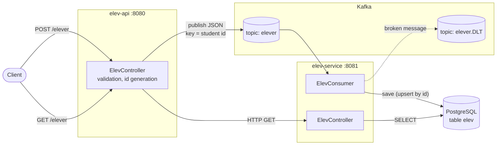

# elev-kafka-rest

[](https://github.com/VadimAndroid/elev-kafka-rest/actions/workflows/ci.yml)

Two Spring Boot services in Kotlin that manage students (*elever*). They talk to each other
**asynchronously over Kafka** (create) and **synchronously over HTTP** (read).
Students are stored in **PostgreSQL**.

> This is the **`portfolio`** branch. The original school assignment (H2 database, Norwegian README) is on `main`.

## Tech stack

Kotlin 2.3 · Java 25 · Spring Boot 4.1 · Spring Kafka · Spring Data JPA / Hibernate · PostgreSQL 17 · Flyway ·
Apache Kafka 4.3 (KRaft) · Spring Boot Actuator · JUnit 5 · MockMvc · Mockito · Testcontainers · Awaitility ·
Docker / Docker Compose · GitHub Actions

## Architecture



| Service | Port | Responsibility |
|---------|------|----------------|
| `elev-api` | 8080 | The only entry point for clients. Validates input, generates the id, publishes to Kafka, reads from `elev-service`. Has no database. |
| `elev-service` | 8081 | Consumes students from Kafka and stores them in PostgreSQL. Exposes read endpoints. |
| Kafka | 9092 | Message broker (KRaft mode, no ZooKeeper). |
| PostgreSQL | 5432 | Database for `elev-service`, data in the Docker volume `elev-pgdata`. |

### Why Kafka for create and HTTP for read?

- **Create is asynchronous.** `elev-api` does not depend on `elev-service` being up. The message waits in Kafka
  until it is consumed, so no student is lost. That is why `POST` returns **202 Accepted**, not 201 Created:
  the student is accepted, but maybe not stored yet.
- **Read is synchronous.** The client needs the answer now. If `elev-service` is down, `elev-api` returns
  **503 Service Unavailable**, not an empty list, because an empty list would be wrong information.

## Running

Requirements: **Docker Desktop**, and **Java 25** to run outside Docker.

### Everything in Docker

```bash
docker compose --profile app up -d --build
docker compose ps                      # all four containers should be "healthy"
```

Stop with `docker compose --profile app down`. Add `-v` to also delete the database volume.

### Services from IntelliJ / Gradle (development)

```bash
docker compose up -d                   # only Kafka and PostgreSQL
cd elev-service && ./gradlew bootRun   # terminal 1
cd elev-api && ./gradlew bootRun       # terminal 2
```

The app services are in the compose profile `app`, so plain `docker compose up -d` starts only the infrastructure.

### Try it

```bash
curl -i -X POST localhost:8080/elever -H 'Content-Type: application/json' \
  -d '{"navn":"Ola Nordmann","klasse":"10A"}'
curl localhost:8080/elever
curl localhost:8080/elever/<id>
curl localhost:8080/actuator/health
```

## API

### elev-api (port 8080)

| Method | Path | Response |
|--------|------|----------|
| POST | `/elever` | `202` with the student (incl. id) · `400` if `navn`/`klasse` is blank · `503` if Kafka fails |
| GET | `/elever` | `200` with a list (possibly `[]`) · `503` if `elev-service` is down |
| GET | `/elever/{id}` | `200` · `404` if not found · `503` if `elev-service` is down |
| GET | `/actuator/health` | `200` `{"status":"UP"}` |

Request body: `{ "navn": "Ola Nordmann", "klasse": "10A" }`

### elev-service (port 8081)

| Method | Path | Response |
|--------|------|----------|
| GET | `/elever` | `200` with all students from the database |
| GET | `/elever/{id}` | `200` · `404` if not in the database |
| GET | `/actuator/health` | `200` when the app and the database are up |

## Design decisions

### Database and migrations

- The schema is created by **Flyway** (`elev-service/src/main/resources/db/migration/V1__opprett_elev_tabell.sql`),
  not by Hibernate. Hibernate runs with `ddl-auto=validate` and only checks that `ElevEntity` matches the table.
- An applied migration is never edited (Flyway detects it by checksum). Schema changes go in a new `V2__...sql`.
- `ElevEntity` (JPA, mutable) is kept separate from `Elev` (immutable data class used in JSON).

### No duplicates (idempotent consumer)

Kafka delivers **at least once**, so the same message can be read twice.
The student id is generated by `elev-api`, sent in the message and used as the **primary key**.
`save()` therefore does `SELECT` → `INSERT` if new, `UPDATE` if it exists. There can only be one row per id.

The id is also the Kafka message key, so all messages for one student go to the same partition, in order.

### Error handling: Dead Letter Topic

A message that can never be processed (a *poison pill*, e.g. broken JSON) must not block the partition.
`KafkaConfig` sets up a `DefaultErrorHandler`:

- temporary errors (e.g. the database is down for a moment) are retried **3 times, 1 second apart**
- JSON errors are **not retried**, because they will never succeed
- after that, the message is published unchanged to **`elever.DLT`**, and the consumer continues with the next message

Inspect the DLT:

```bash
docker exec kafka /opt/kafka/bin/kafka-console-consumer.sh \
  --bootstrap-server localhost:9092 --topic elever.DLT --from-beginning
```

### Kafka listeners

Containers reach Kafka at `kafka:29092`, while programs on the host reach it at `localhost:9092`.
Kafka tells clients which address to use (*advertised listeners*), so it has two listeners: `INTERNAL` and `EXTERNAL`.

### Configuration

All addresses come from environment variables with local defaults, for example
`${KAFKA_BOOTSTRAP_SERVERS:localhost:9092}`. The code is the same everywhere. Only the environment changes.

| Variable | Service | Local default | In Docker |
|----------|---------|---------------|-----------|
| `KAFKA_BOOTSTRAP_SERVERS` | both | `localhost:9092` | `kafka:29092` |
| `ELEV_SERVICE_URL` | elev-api | `http://localhost:8081` | `http://elev-service:8081` |
| `DB_URL` | elev-service | `jdbc:postgresql://localhost:5432/elevdb` | `jdbc:postgresql://postgres:5432/elevdb` |
| `DB_USER` / `DB_PASSWORD` | elev-service | `elev` / `elev` | `elev` / `elev` |

### Docker images

Multi-stage `Dockerfile`: the jar is built with Gradle in `eclipse-temurin:25-jdk`, and runs in the smaller
`eclipse-temurin:25-jre` as a non-root user. Compose healthchecks use `/actuator/health`, and `elev-api`
starts only when `elev-service` is healthy.

## Tests

```bash
cd elev-service && ./gradlew test   # needs Docker (Testcontainers)
cd elev-api && ./gradlew test
```

| Service | Type | What is tested |
|---------|------|----------------|
| `elev-service` | Integration, **Testcontainers** (real PostgreSQL + Kafka) | Kafka message → database → GET · the same message twice gives one row · a broken message goes to the DLT and does not block the next one · empty list · 404 |
| `elev-api` | Web layer, `@WebMvcTest` + Mockito mocks | `202` (and input is trimmed) · `400` and nothing sent to Kafka · `503` when Kafka fails · `200` · `404` · `503` when `elev-service` is down |

The Testcontainers tests start their own containers and never touch the compose database.

### CI

`.github/workflows/ci.yml` runs on every push and pull request:

1. **Test**: `./gradlew test` for both services in parallel (Testcontainers uses Docker on the runner).
2. **Docker image**: builds both Dockerfiles, only if the tests pass. Images are not published.

The test report is uploaded as an artifact when a test fails.

## Inspecting the database

```bash
docker exec -it elev-postgres psql -U elev -d elevdb
```

```sql
SELECT * FROM elev;
SELECT * FROM flyway_schema_history;
```

IntelliJ: Database → `+` → Data Source → PostgreSQL → `localhost:5432`, database `elevdb`, user/password `elev`/`elev`.
